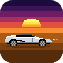
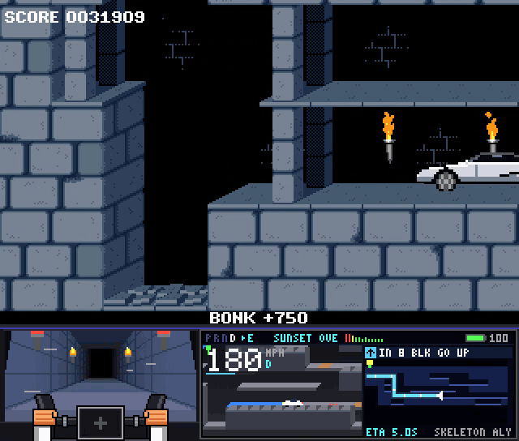

<p align="center">
  
</p>

<h1 align="center">Prince of Persia: Roadster Mod</h1>

<p align="center">
  <b>The prince finds an electric roadster in level 1. It goes downhill from there. Fast.</b><br>
  Wall rides, barrel rolls, a hover jetpack and ludicrous mode, in the 1989 classic. Runs in your browser.
</p>

<p align="center">
  <a href="https://eternaleclipse.github.io/pop-roadster/"></a>
  
  
  
  <a href="LICENSE"></a>
</p>

<p align="center">
  <a href="https://eternaleclipse.github.io/pop-roadster/"><b>Play</b></a> ·
  <a href="docs/features.md">Features</a> ·
  <a href="docs/controls.md">Controls</a> ·
  <a href="docs/options.md">Options</a> ·
  <a href="docs/custom-levels.md">Custom Levels</a>
</p>

<p align="center">
  
</p>

## What it does

- **A car in a 1989 dungeon.** Gates get rammed open, guards get run over, spikes and choppers don't matter.
- **Magnetic tires.** Drive up walls, across the ceiling and around corners.
- **Stunts and combos.** Barrel rolls, corkscrews, drifts and air 180s, with multipliers up to x10.
- **A real cockpit.** A first-person windshield view of the level, a 3D surround view, and GPS that plans the route to every exit.
- **Fully synthesized sound.** Bass-heavy motor, crashes and five high-energy tracks on the stereo, no samples.
- **A charging stop.** Wait for the battery while scrolling Princestagram.
- **A new ending.** "Need a ride?"

<p align="center">
  
  
  
</p>

[All features](docs/features.md)

## Quick Start

```sh
git clone https://github.com/eternaleclipse/pop-roadster && cd pop-roadster
npm install && npm start   # any static web server works
```

Then open `localhost:8080`. Jump straight into the car with `?level=2`.

## Credits

Built on [PrinceJS](https://github.com/oklemenz/PrinceJS) by [oklemenz](https://github.com/oklemenz), which builds on
[PrinceJS](https://github.com/ultrabolido/PrinceJS) by [ultrabolido](https://github.com/ultrabolido).
Prince of Persia was created by [Jordan Mechner](https://github.com/jmechner).
