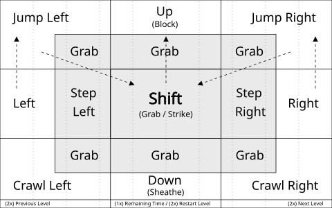

# Controls

[← Back to README](../README.md)

## In the roadster

| Key            | What it does                                                             |
| -------------- | ------------------------------------------------------------------------ |
| `Left / Right` | Accelerate, turn around. On walls the key you were holding stays the gas |
| `Up`           | Jump. Keep holding to barrel roll                                        |
| `Down` (air)   | Corkscrew                                                                |
| `SPACE`        | Hover jetpack. `Up / Down` change altitude, `Left / Right` steer         |
| `SHIFT`        | Ludicrous mode: 300+ MPH, rocket thrust in the air, smash walls          |
| `G`            | Hide or show the GPS route                                               |
| `M` / `N`      | Mute or skip the stereo                                                  |

At the charging stop: `Up / Down` scroll Princestagram, `SPACE` likes a post, `Right` unplugs once the battery is full.

### Touch

Phones and tablets get on-screen buttons: arrows on the left (`▲` over `◀ ▼ ▶`), `BOOST` and `HOVER` on the right.
Several can be held at once. Add `?touch=1` to the URL to force them on, `?touch=0` to hide them.

## On foot (level 1)

- Keyboard
  - `Left / Right`: Move, Advance/Retreat
  - `Up`: Jump, Climb Up, Block Attack
  - `Down`: Crouch, Crawl, Climb Down, Sheathe Sword
  - `SHIFT`: Drink Potion, Grab Edge, Sword Strike
  - `SPACE`: Show Remaining Time
  - `ENTER`: Continue Game
- Game controller
  - `Left / Right Stick, DPad`: Movement
  - `A / R / ZR`: Jump, Climb Up, Block Attack
  - `B / Y / L / ZL`: Drink Potion, Grab Edge, Sword Strike
  - `X`: (1x) Show Remaining Time, (2x) Restart Level
  - `Minus / Plus`: Previous / Next Level
- Touch (tap or drag areas on screen, fight mode in brackets)

  
  - _Run Jump_: Tap Left or Right -> Hold -> Drag in Left or Right corner
  - _Jump Grab_: (Run) Jump -> Hold -> Drag to Center (Shift)

## On a phone

- Use landscape mode and a single tab
- Add to Home Screen to start as a fullscreen app
- Easier guards: [`?strength=50`](https://eternaleclipse.github.io/pop-roadster/?strength=50)
