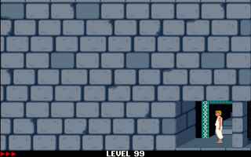
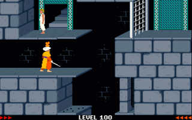

# Custom Levels

[← Back to README](../README.md)

Apoplexy (https://apoplexy.github.io/apoplexysite/) can be used to build custom
levels.
Custom levels can be played performing the following steps.

## Single Conversion

- Save level as XML file in Apoplexy, e.g. `./xml/level1.xml`
- Call convert script, e.g. `npm run convert .../xml/level1.xml`
  - A JSON file is placed at `/assets/maps/`, e.g. `/assets/maps/level101.json`
- Custom level ids starts beyond 100, e.g. `level1.xml` gets id `101`, etc.
  - An optional second parameter can be used to control level offset
  - e.g. `npm run convert .../xml/level1.xml 200` generates `/assets/maps/level201.json`
- Start game locally with `npm start` and open game in browser
- Change Url and set parameter `level` to the respective id, e.g. `level=101`
- Note: No special events are supported

## Batch Conversion

- Place level files into folder `/converter/<xxx>`, where `<xxx>` stands for the offset (default: 100)
  - e.g. `/converter/100`: place all levels starting with 100 offset
- Execute `npm run convert`
- Corresponding JSON files are placed at `/assets/maps/`

## Level Numbers

Converted levels from https://www.popot.org/custom_levels.php:

- [99](https://eternaleclipse.github.io/pop-roadster/?level=99&strength=50): Chamber Play (own)
- [100](https://eternaleclipse.github.io/pop-roadster/?level=100&strength=50): Tower of Revenge (own)
- [101-114](https://eternaleclipse.github.io/pop-roadster/?level=101&strength=50): Prince of Persia Revisited ([source](https://www.popot.org/custom_levels.php?mod=0000163))
- [115-128](https://eternaleclipse.github.io/pop-roadster/?level=115&strength=50): Jaffar's House ([source](https://www.popot.org/custom_levels.php?mod=0000220))
- [129-142](https://eternaleclipse.github.io/pop-roadster/?level=129&strength=50): Ipank's Levels ([source](https://www.popot.org/custom_levels.php?mod=0000151))
- [143-156](https://eternaleclipse.github.io/pop-roadster/?level=143&strength=50): Barre's Alternative ([source](https://www.popot.org/custom_levels.php?mod=0000189))
- [157-170](https://eternaleclipse.github.io/pop-roadster/?level=157&strength=50): Miracles Don't Exist ([source](https://www.popot.org/custom_levels.php?mod=0000098))
- [171-184](https://eternaleclipse.github.io/pop-roadster/?level=171&strength=50): Babylon Tower Climb ([source](https://www.popot.org/custom_levels.php?mod=0000109))
- [185-198](https://eternaleclipse.github.io/pop-roadster/?level=185&strength=50): Lost in Errors ([source](https://www.popot.org/custom_levels.php?mod=0000144))
- [199-212](https://eternaleclipse.github.io/pop-roadster/?level=199&strength=50): Story Retold ([source](https://www.popot.org/custom_levels.php?mod=0000146))
- [213-226](https://eternaleclipse.github.io/pop-roadster/?level=213&strength=50): Prince of Persia Guard Revolt ([source](https://www.popot.org/custom_levels.php?mod=0000162))
- [227-240](https://eternaleclipse.github.io/pop-roadster/?level=227&strength=50): Return of Prince ([source](https://www.popot.org/custom_levels.php?mod=0000207))
- [241-254](https://eternaleclipse.github.io/pop-roadster/?level=241&strength=50): The Sequel ([source](https://www.popot.org/custom_levels.php?mod=0000273))
- [255-268](https://eternaleclipse.github.io/pop-roadster/?level=255&strength=50): Nahemsan ([source](https://www.popot.org/custom_levels.php?mod=0000272))
- [269-282](https://eternaleclipse.github.io/pop-roadster/?level=269&strength=50): 4-Rooms Levelset ([source](https://www.popot.org/custom_levels.php?mod=0000052))
- [283-296](https://eternaleclipse.github.io/pop-roadster/?level=283&strength=50): Repetition of Time ([source](https://www.popot.org/custom_levels.php?mod=0000010))
- [297-310](https://eternaleclipse.github.io/pop-roadster/?level=297&strength=50): Same Story Different Version ([source](https://www.popot.org/custom_levels.php?mod=0000276))

## Level Walkthrough

- **Level 99:** https://youtu.be/Aj3tfAaXD4c

- **Level 100:** https://youtu.be/PAHACXdWQ_M

