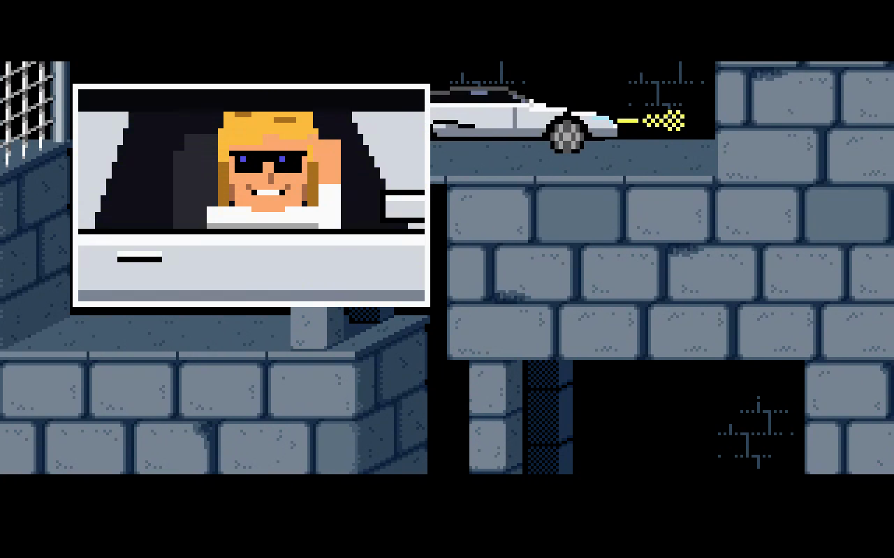
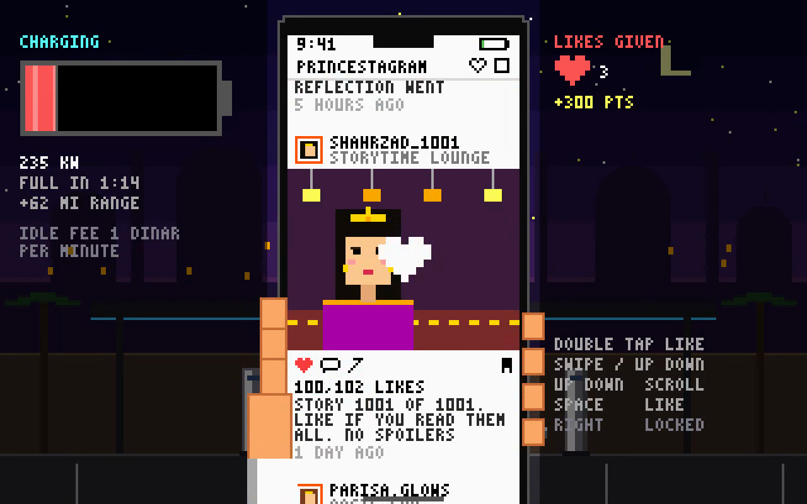
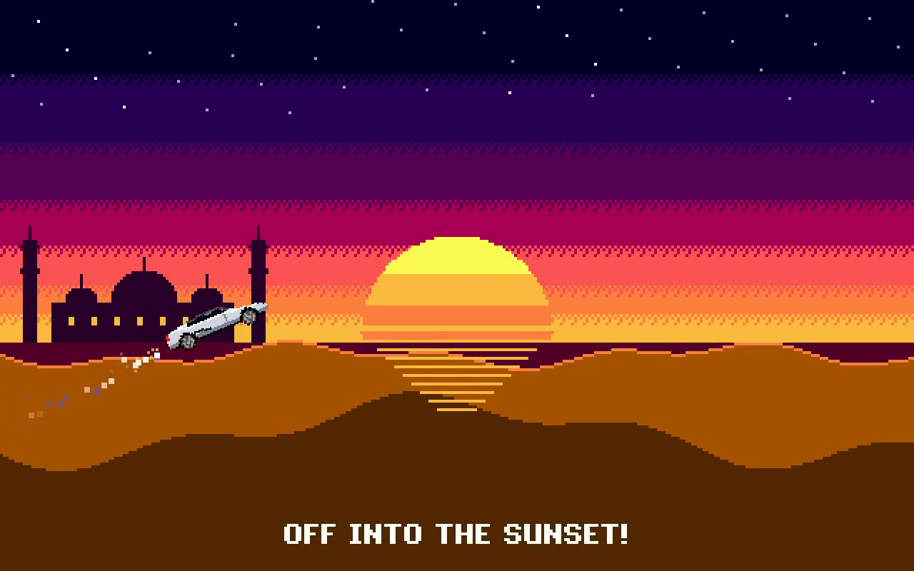

# Features

[← Back to README](../README.md)

In the first level the prince discovers a big pixel-art electric roadster parked a few steps away. A short
letterboxed cutscene plays: the headlights blink, he walks over, gets in, and floors it: a huge bass VOOM with the inverter whine climbing.
A close-up shows him rolling down the window, flashing his sunglasses and running a hand through his hair
("DUDE, THIS IS SICK!") while the motor revs in the background.
From level 2 on, every level starts in the car, even after a page reload, (`src/Roadster.js`):

- While driving, a cockpit appears under the playfield (see Dashboard below)
- `Left / Right`: Accelerate / turn around (on walls, the key you were holding stays the gas)
- `Up`: Jump. Keep holding to barrel roll; `Down` in the air corkscrews. Land clean for a speed bonus
- `SPACE`: Hover jetpack. The car floats level; `Up / Down` change altitude, `Left / Right` steer. Release to drop
- `SHIFT`: Ludicrous mode. Faster acceleration, 300+ MPH, rocket thrust in the air, and walls get smashed at speed
- Magnetic tires: drive into a wall that leads somewhere to ride up it, across the ceiling and around corners. `Up` jumps off
- Touch screens get on-screen buttons (`src/TouchControls.js`): arrows on the left in a WASD layout
  (`▲` over `◀ ▼ ▶`); `BOOST` and `HOVER` on the right. Several can be held at once. Add `?touch=1` to the URL to force them on, `?touch=0` to hide them
- All car sounds are synthesized bass (motor, thuds, crashes, smashes). No sampled human sounds
- Gates are rammed open, guards are run over, loose floors crumble behind you, spikes and choppers don't matter
- GPS (`src/RoadsterGPS.js`): every level is route-planned to the exit, including drops, climbs, walls to smash and
  floors to break through. The yellow arrow follows the route, and the nav map on the cockpit screen shows it with an
  ETA and turn-by-turn directions ("IN 4 BLK GO UP", "RECALCULATING..."). `G` hides the route
- The car never gets stuck: walls with nowhere to climb get smashed at any speed, the route breaks through floors
  when that is faster, the car dives into gaps it should drop down and hops up through gaps in the ceiling. The only
  thing it stops at is the edge of the level map. On floors and ceilings the arrows always mean their screen direction
- Stunts with a score and a combo multiplier (x2 to x10 for stunts landed within 3 seconds of each other): barrel
  rolls and corkscrews (`Up` / `Down` in the air, drawn in 3D with top and underside views), drifts
  (opposite arrow at speed: the car slides on with tire smoke and a screech, swings round through its front view and
  launches back the other way), air 180s, wall and ceiling rides, loops, sky drops,
  smashes, break-throughs and roadkill. Pit jumps, ceiling hops and long drops add an automatic roll
- Dashboard (`src/RoadsterDash.js`): while driving, the canvas grows downward into a pixel-art cockpit. The windshield
  shows a first-person view from the driver's seat: the corridor ahead in perspective, cast from the real level along
  the car's nose with the roof as "up" (so falls, wall and ceiling rides and barrel rolls look right), with torches,
  gates at their real height, lit exit doors, spikes, choppers, potions and detailed guards, skeletons and the vizier.
  A yoke-style wheel turns only when the car really turns (drifts and turnarounds). The center screen is split like a
  modern EV display: a 3D view of the car's surroundings (blocks, guards turning orange when close, hazards, the
  route in blue) with speed, gear and power, next to the nav map with directions, ETA and street names. The top bar
  has the gear, song, spectrum and battery. Score and combo stay in the top left
- Charging stop (`src/RoadsterCharge.js`): between levels 4 and 5 the car pulls into a desert charger and plugs in. The
  cable stays locked until the battery is full (about 75 seconds). Meanwhile the prince scrolls PRINCESTAGRAM, an endless
  feed of princesses (different looks, backdrops, poses and captions, with the odd ad and a Jaffar post): `Up / Down`
  scroll, `SPACE` likes (+100 points), notifications pop up, and `Right` unplugs and drives on once charged
- Stereo (`src/RoadsterRadio.js`): turns itself on when you drive off and shuffles between five synthesized
  high-energy instrumentals. Its EQ follows the car (more bass with speed, everything maxed on BOOST) and shows
  as a pixel spectrum on the cockpit screen. `M` mutes, `N` skips
- Rewritten story pages for the intro and the
  "Marry Jaffar" page, drawn in the original style (`assets/gfx/roadster_*.png`)
- New ending (`src/RoadsterEnding.js`): the prince parks in the princess's chamber, rolls down the window
  ("NEED A RIDE?"), climbs out, she runs into his arms, they both get in and rocket off into a pixel-art sunset

  

